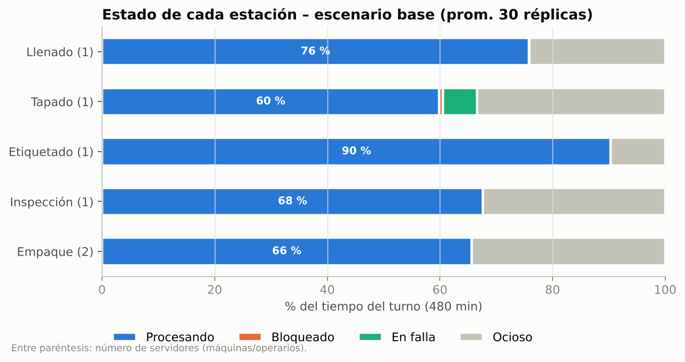

# Simulación de una línea de producción de agua embotellada (FlexSim)

Modelo de simulación de eventos discretos de la línea

**Recepción de materia prima → Llenado → Tapado → Etiquetado → Inspección → Empaque**

para medir la capacidad de producción, la utilización de los recursos, la acumulación de botellas
entre estaciones y los cuellos de botella, y para comparar escenarios de mejora.

## Contenido

| Carpeta / archivo | Qué contiene | Parte de la actividad |
|---|---|---|
| [`docs/01_conceptualizacion.md`](docs/01_conceptualizacion.md) | Problema, objetivo, fronteras, entidades, recursos, colas, eventos, variables, KPI y supuestos | Conceptualización del modelo |
| [`docs/02_coleccion_datos.md`](docs/02_coleccion_datos.md) | Tabla de datos completa con distribuciones, método de obtención, ajuste de distribuciones y capacidad de cada estación | Colección de datos |
| [`docs/03_diagrama_conceptual.md`](docs/03_diagrama_conceptual.md) + [`diagrama_conceptual.png`](docs/diagrama_conceptual.png) | Diagrama de flujo con las decisiones y la distribución del modelo en FlexSim | Diagrama conceptual |
| [`docs/04_guia_flexsim_paso_a_paso.md`](docs/04_guia_flexsim_paso_a_paso.md) | Construcción en FlexSim (automática con scripts o manual), operarios, fallas, tablero, Experimenter, verificación y validación | Desarrollo del modelo |
| [`docs/05_resultados_y_escenarios.md`](docs/05_resultados_y_escenarios.md) | Resultados, cuello de botella, 7 escenarios, conclusiones y recomendaciones | Análisis |
| [`flexsim/01_construir_modelo.fs`](flexsim/01_construir_modelo.fs) | Script de FlexSim que arma la línea completa | — |
| [`flexsim/02_distribuciones_y_ruteo.fs`](flexsim/02_distribuciones_y_ruteo.fs) | Script que carga las distribuciones y la decisión de calidad | — |
| [`flexsim/03_reporte_kpi.fs`](flexsim/03_reporte_kpi.fs) | Script que imprime los indicadores al terminar la corrida | — |
| [`datos/parametros_modelo.csv`](datos/parametros_modelo.csv) | Datos de entrada (se abre en Excel) | — |
| [`datos/formato_cronometraje.csv`](datos/formato_cronometraje.csv) | Formato para tomar tiempos en planta | — |
| [`validacion_python/`](validacion_python) | Modelo gemelo en Python (SimPy) con 30 réplicas por escenario, gráficas y CSV de resultados | Verificación |

## Inicio rápido en FlexSim (5 minutos)

1. **File → New Model** con *Time Units = Minutes* y *Length Units = Meters*.
2. Barra superior **Script** → pega `flexsim/01_construir_modelo.fs` → **Execute**.
3. Guarda (**Ctrl+S**) → pega `flexsim/02_distribuciones_y_ruteo.fs` → **Execute**.
4. Marca **Use Operator(s) for Process** en `Inspeccion` y en `Empaque`.
5. Agrega las fallas de la tapadora en *Toolbox → MTBF MTTR* (paso 7 de la guía).
6. *Stop Time* = 480 → **Reset** → **Run**.
7. Pega `flexsim/03_reporte_kpi.fs` → **Execute** para ver los indicadores.

La explicación completa, con la opción de armarlo a mano, está en la
[guía paso a paso](docs/04_guia_flexsim_paso_a_paso.md).

## El modelo en una tabla

| Etapa | Objeto FlexSim | Tiempo (min) | Capacidad | Cola antes |
|---|---|---|---|---|
| Recepción de materia prima | Source `Recepcion_MP` | Exponencial(0.48) entre llegadas | 125 bot/h | — |
| Llenado | Processor `Llenado` | Triangular(0.30, 0.35, 0.45) | 164 bot/h | `Almacen_MP` (1000) |
| Tapado | Processor `Tapado` + MTBF/MTTR | Uniforme(0.25, 0.33); falla cada ~60 min, reparación 2 a 6 min | 195 bot/h | `Buffer_Tapado` (15) |
| Etiquetado | Processor `Etiquetado` | Triangular(0.38, 0.42, 0.52) | **136 bot/h** | `Buffer_Etiquetado` (20) |
| Inspección | Processor `Inspeccion` + `Inspector` | Normal(0.33, 0.03); 4 % defectuosas | 182 bot/h | `Buffer_Inspeccion` (15) |
| Empaque | Processor `Empaque` (2 puestos) + 2 empacadores | Triangular(0.55, 0.65, 0.80) | 180 bot/h | `Buffer_Empaque` (20) |
| Salida | Sinks `Producto_Terminado` y `Producto_Defectuoso` | — | — | — |

## Resultados principales (30 réplicas de un turno de 8 h)

- **Producción actual:** 117.9 ± 1.4 botellas buenas/h (943 por turno) y 5 defectuosas/h.
- **Capacidad máxima de la línea:** 130 botellas buenas/h (≈ 1040 por turno).
- **Cuello de botella: la etiquetadora**, con 90 % de utilización, la cola más larga (hasta 20
  botellas) y 2.1 min de espera de los 5.2 min que tarda una botella en la línea.
- **Acumulaciones repentinas antes de la tapadora** por sus fallas. A veces llenan la banda y
  **bloquean la llenadora**.
- **Recursos:** llenadora 76 %, tapadora 60 % (+6 % en falla), inspector 68 %, empacadores 66 %.
- **Con demanda +20 %** la línea actual se satura (27 min en el sistema, almacén con hasta 91
  botellas). **Con una segunda etiquetadora** produce 143 botellas/h, y el siguiente cuello de botella
  es la llenadora.
- **El mantenimiento preventivo de la tapadora** reduce 22 % el tiempo en el sistema sin invertir
  en máquinas.



## Modelo de validación en Python

```bash
cd validacion_python
pip install -r requirements.txt
python linea_embotellado.py                 # 7 escenarios × 30 réplicas + gráficas
python linea_embotellado.py --verificacion  # prueba determinista (valores esperados en FlexSim)
python linea_embotellado.py --escenario etiq2 --reps 10
```

## Notas importantes

- **Datos supuestos:** la actividad no entrega tiempos, así que se usan valores razonables para
  este tipo de línea. Para usar datos reales basta con cambiarlos en `datos/parametros_modelo.csv`,
  en los scripts de FlexSim y en `BASE` dentro de `validacion_python/linea_embotellado.py`.
- **Scripts de FlexSim:** solo usan funciones de FlexScript documentadas o probadas por la comunidad
  en FlexSim 2026 (`Object.create`, `contextdragconnection`, `setProperty`/`getProperty`,
  `stats`). No se pudieron ejecutar aquí porque FlexSim es un programa de Windows con licencia. Si
  algún paso falla en tu versión, la guía explica cómo hacerlo a mano.
