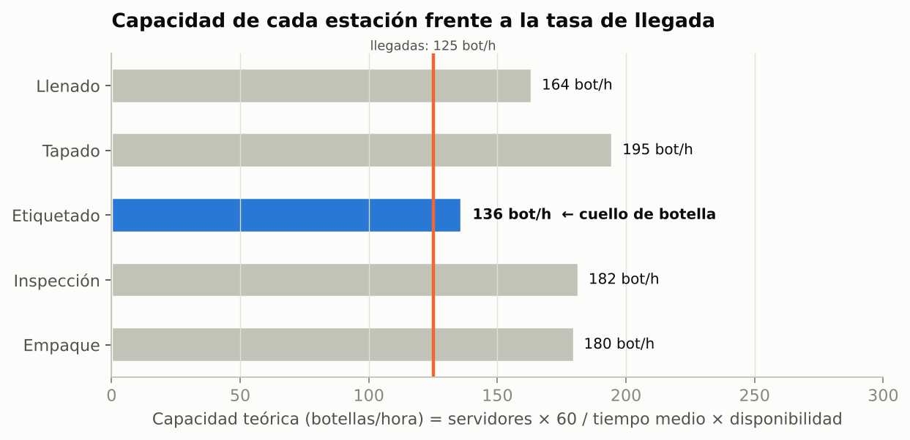

# 2. Colección de datos

## 2.1 Información requerida

La tabla de la actividad, completada con el valor o la distribución que usa el modelo. Los mismos datos
están en formato de hoja de cálculo en [`../datos/parametros_modelo.csv`](../datos/parametros_modelo.csv).

| Variable | Unidad | Método de obtención | Distribución usada en el modelo | Media |
|---|---|---|---|---|
| Tiempo entre llegadas | minutos | Cronometraje | Exponencial (media 0.48) | 0.48 min → 125 botellas/h |
| Tiempo de llenado | minutos | Cronometraje | Triangular (mín 0.30, moda 0.35, máx 0.45) | 0.367 min |
| Tiempo de tapado | minutos | Cronometraje | Uniforme (0.25, 0.33) | 0.290 min |
| Tiempo de etiquetado | minutos | Cronometraje | Triangular (mín 0.38, moda 0.42, máx 0.52) | 0.440 min |
| Tiempo de inspección | minutos | Cronometraje | Normal (media 0.33, desv. 0.03) | 0.330 min |
| Tiempo de empaque | minutos | Cronometraje | Triangular (mín 0.55, moda 0.65, máx 0.80) por empacador | 0.667 min |
| Botellas producidas | botellas/hora | Conteo | **Resultado** del modelo (se usa para validar) | ≈ 118 botellas/h |
| Botellas defectuosas | botellas/hora | Registro | 4 % de las inspeccionadas (Bernoulli) | ≈ 5 botellas/h |
| Número de operadores | personas | Observación | 1 inspector + 2 empacadores | 3 |
| Capacidad de cada estación | botellas/hora | Registro/observación | Calculada (tabla 2.3) | — |
| *Adicional:* tiempo entre fallas de la tapadora | minutos | Registro de mantenimiento | Exponencial (media 60) | 60 min |
| *Adicional:* tiempo de reparación de la tapadora | minutos | Registro de mantenimiento | Triangular (mín 2, moda 3, máx 6) | 3.67 min |
| *Adicional:* capacidad de las colas | botellas | Observación | Almacén 1000; bandas 15, 20, 15 y 20 | — |

> Los valores son **supuestos de ejercicio** (la actividad no proporciona datos). Se eligieron para
> que sean coherentes con lo que describe la empresa: acumulaciones en algunos momentos (fallas y
> variabilidad) y una estación que limita la línea.

## 2.2 Cómo se obtendrían los datos en la planta

1. **Cronometraje.** Con un cronómetro (o video), registrar de 30 a 50 observaciones por estación, en
   distintos momentos del turno, usando el formato
   [`../datos/formato_cronometraje.csv`](../datos/formato_cronometraje.csv).
   - Tiempo entre llegadas: hora de llegada de una botella menos la hora de la anterior.
   - Tiempo de proceso: desde que la botella entra a la máquina hasta que queda lista para salir
     (no incluir el tiempo que pasa esperando en la banda).
2. **Tamaño de muestra.** Con una muestra piloto de *n₀* observaciones se estima
   `n = (t · s / e)²`, donde *s* es la desviación estándar, *e* el error aceptable (por ejemplo 5 % de
   la media) y *t* el valor t de Student al 95 %.
3. **Conteo y registro.** Botellas producidas y defectuosas por hora a partir de los reportes de
   producción y de calidad; fallas a partir de la bitácora de mantenimiento.
4. **Observación.** Número de operarios por estación y qué tareas realiza cada uno.

## 2.3 Ajuste de distribuciones

Con los datos cronometrados:

1. Revisar que no haya datos atípicos por errores de registro.
2. Comprobar independencia (gráfica de dispersión del dato *i* contra el *i+1*, o prueba de rachas).
3. Ajustar una distribución con **ExpertFit** (incluido en FlexSim: *Statistics → ExpertFit*),
   Stat::Fit o Input Analyzer, y validar con la prueba **Chi-cuadrada** o
   **Kolmogorov-Smirnov** (nivel de significancia 5 %).
4. Criterio práctico cuando hay pocos datos: usar **triangular (mínimo, moda, máximo)**; para tiempos
   entre llegadas aleatorias, **exponencial**; para tareas manuales repetitivas, **normal**.

> **Cuidado con el orden de los parámetros en FlexSim:** `triangular(mínimo, máximo, moda, stream)`.
> La moda va al final, a diferencia de la notación habitual de los libros.

## 2.4 Capacidad teórica de cada estación

Capacidad = servidores × 60 ÷ tiempo medio × disponibilidad. Para la tapadora, la disponibilidad es
MTBF ÷ (MTBF + MTTR) = 60 ÷ (60 + 3.67) = 94.2 %.

| Estación | Tiempo medio (min) | Servidores | Disponibilidad | Capacidad (botellas/h) | Carga (botellas/h) | Utilización esperada |
|---|---|---|---|---|---|---|
| Llenado | 0.367 | 1 | 100 % | 163.6 | 125 | 76.4 % |
| Tapado | 0.290 | 1 | 94.2 % | 195.0 | 125 | 64.1 % |
| **Etiquetado** | **0.440** | **1** | **100 %** | **136.4** | **125** | **91.7 %** |
| Inspección | 0.330 | 1 | 100 % | 181.8 | 125 | 68.8 % |
| Empaque | 0.667 | 2 | 100 % | 180.0 | 120 | 66.7 % |

**Conclusión del análisis de datos:** la etiquetadora es la estación de **menor capacidad (136.4
botellas/h)**. Es el cuello de botella esperado y fija la capacidad máxima de la línea en
136.4 × 0.96 ≈ **131 botellas buenas por hora**. Con 125 botellas/h de llegada trabaja al 91.7 %, muy
cerca de su límite, por eso es donde se forman las colas más grandes. La simulación confirma este
cálculo y además muestra el efecto de la variabilidad, las fallas y el bloqueo, que el cálculo
estático no captura.
