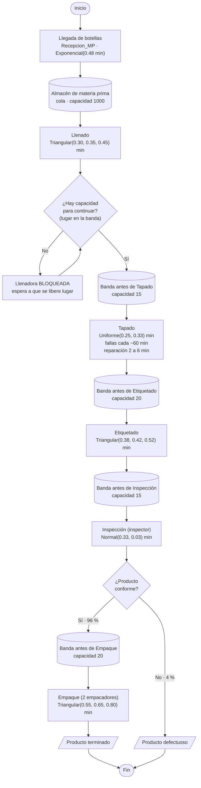

# 3. Diagrama conceptual

## 3.1 Diagrama de flujo del proceso

Es el diagrama de la actividad, con los datos y las colas del modelo. Una imagen del mismo diagrama
para pegar en el reporte está en [`diagrama_conceptual.png`](diagrama_conceptual.png).



**Cómo leer las decisiones:**

- **¿Hay capacidad para continuar?** Se aplica a **cada** estación. Cuando la cola siguiente está
  llena, la máquina termina su botella pero no puede soltarla y queda en estado *bloqueado*. En
  FlexSim esto ocurre solo con fijar la capacidad máxima (*Maximum Content*) de cada Queue.
- **¿Producto conforme?** En FlexSim se programa con *Send To Port* de Inspección:
  `bernoulli(96, 1, 2)` manda el 96 % al puerto 1 (empaque) y el 4 % al puerto 2 (defectuoso).

## 3.2 Distribución del modelo en FlexSim (vista superior)

```
                                   Inspector                 Empacador_1  Empacador_2
                                       ●                           ●          ●
                                       ┆ (S)                        ╲   (A)   ╱
                                       ┆                          Equipo_Empaque (Dispatcher)
                                       ┆                                ┆ (S)
 [Source]→[Queue]→[Proc]→[Queue]→[Proc]→[Queue]→[Proc]→[Queue]→[Proc]→[Queue]→[Proc]→[Sink]
 Recepcion Almacen Llenado Buffer  Tapado  Buffer  Etique- Buffer  Inspec- Buffer  Empaque Producto
 _MP       _MP             _Tapado         _Etiq.  tado    _Insp.  cion  │ _Empaque         _Terminado
                                                                         ↓ puerto 2
                                                                   [Sink] Producto_Defectuoso
  x = 0     4       8       12      16      20      24      28      32      36      40      44  (m)
```

- Flechas → : conexiones de flujo (en FlexSim se hacen arrastrando con la tecla **A**).
- Líneas punteadas (S): conexiones de recursos (tecla **S**): el Processor pide al operario.
- Inspección tiene **dos salidas**: el puerto 1 va a `Buffer_Empaque` y el puerto 2 a
  `Producto_Defectuoso`. El orden en que se hacen las conexiones define el número de puerto.

## 3.3 Correspondencia entre el diagrama y los objetos

| Bloque del diagrama | Objeto FlexSim | Nombre en el modelo |
|---|---|---|
| Llegada de botellas | Source | `Recepcion_MP` |
| Almacén / bandas (acumulación) | Queue | `Almacen_MP`, `Buffer_Tapado`, `Buffer_Etiquetado`, `Buffer_Inspeccion`, `Buffer_Empaque` |
| Llenado, Tapado, Etiquetado, Inspección, Empaque | Processor | `Llenado`, `Tapado`, `Etiquetado`, `Inspeccion`, `Empaque` |
| Fallas de la tapadora | MTBF/MTTR (Toolbox) | `Fallas_Tapadora` |
| Inspector y empacadores | Operator (+ Dispatcher) | `Inspector`, `Empacador_1`, `Empacador_2`, `Equipo_Empaque` |
| Producto terminado / defectuoso | Sink | `Producto_Terminado`, `Producto_Defectuoso` |
