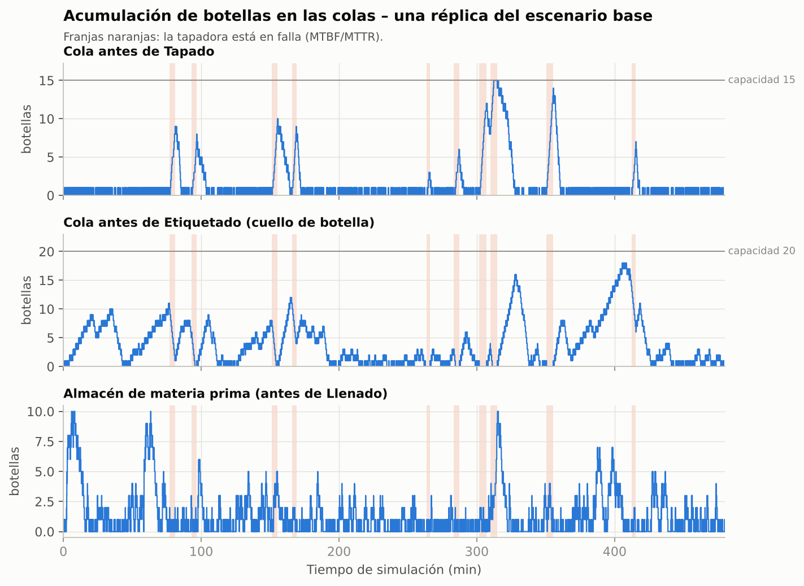
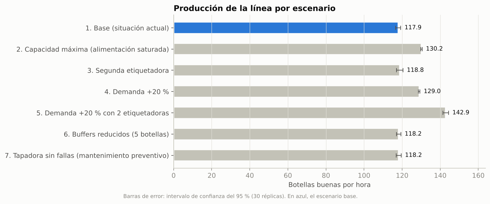
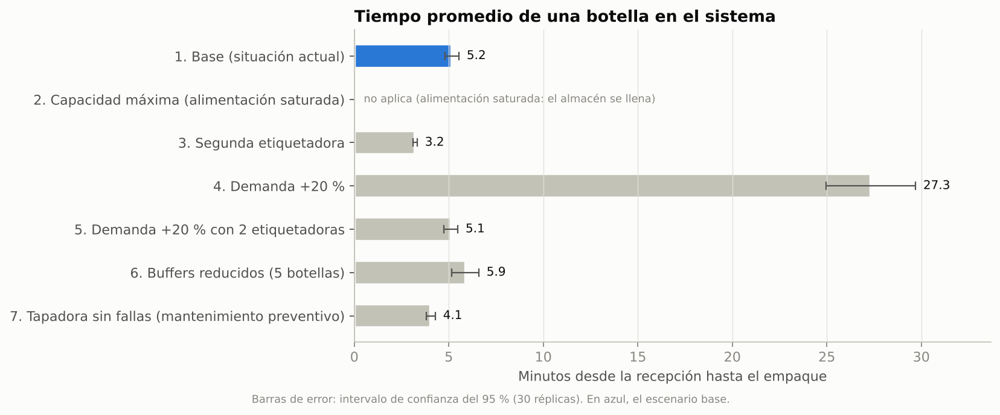

# 5. Resultados, cuellos de botella y escenarios

Los números de esta sección vienen del **modelo gemelo en Python** (`validacion_python/`), que tiene
la misma lógica, datos y unidades que el modelo de FlexSim: **30 réplicas de un turno de 480 min**
por escenario, con intervalos de confianza del 95 %. En FlexSim los resultados deben quedar muy
cerca. Las diferencias pequeñas se deben a los números aleatorios y a detalles como el traslado de
los operarios. Al final hay una tabla para anotar tus resultados de FlexSim y compararlos.

## 5.1 Escenario base (situación actual)

| Indicador | Resultado (IC 95 %) |
|---|---|
| Botellas recibidas por turno | 995 |
| **Producción (botellas buenas)** | **117.9 ± 1.4 botellas/h** (943 por turno) |
| Botellas defectuosas | 5.0 botellas/h (≈ 40 por turno, 4 %) |
| Tiempo promedio de una botella en el sistema | 5.2 ± 0.4 min (máximo promedio 12.3 min) |
| Trabajo en proceso (WIP) promedio | 10.6 botellas |
| Fallas de la tapadora por turno | 8.1 en promedio |

### Utilización de las estaciones y los operarios

| Estación | Procesando | Bloqueada | En falla | Ociosa |
|---|---|---|---|---|
| Llenado | 75.8 % | 0.1 % | — | 24.1 % |
| Tapado | 59.9 % | 0.7 % | 6.0 % | 33.4 % |
| **Etiquetado** | **90.4 %** | 0.0 % | — | 9.6 % |
| Inspección (inspector) | 67.7 % | 0.0 % | — | 32.3 % |
| Empaque (por empacador) | 65.6 % | 0.0 % | — | 34.4 % |

Utilización de operarios: **inspector 67.7 %**, **empacadores 65.6 % cada uno**.

### Acumulación de botellas (colas)

| Cola (antes de…) | Capacidad | Contenido promedio | Máximo (prom. réplicas) | Máximo absoluto | Espera promedio |
|---|---|---|---|---|---|
| Almacén MP (Llenado) | 1000 | 1.25 | 11.4 | 17 | 0.60 min |
| Buffer_Tapado (Tapado) | 15 | 0.74 | 11.9 | **15 (llena)** | 0.35 min |
| **Buffer_Etiquetado (Etiquetado)** | 20 | **4.34** | **16.8** | **20 (llena)** | **2.09 min** |
| Buffer_Inspeccion (Inspección) | 15 | 0.00 | 1 | 1 | 0.00 min |
| Buffer_Empaque (Empaque) | 20 | 0.00 | 1 | 1 | 0.00 min |

### Interpretación

1. **Cuello de botella: Etiquetado.** Es la estación con mayor utilización (90.4 %), la cola más
   grande antes de ella (4.3 botellas en promedio, hasta 20) y la espera más larga (2.1 min, el 40 %
   del tiempo total de una botella en la línea). Coincide con el cálculo de capacidad: es la de menor
   capacidad (136.4 botellas/h) y trabaja muy cerca de su límite.
2. **Por qué hay acumulaciones "en determinados momentos":**
   - **Antes de la tapadora:** cada falla (unos 3.7 min) detiene la tapadora y la banda se llena de
     golpe (picos de 10 a 15 botellas, franjas naranjas de la gráfica). Cuando la banda llega a 15,
     la llenadora queda **bloqueada**: en el diagrama es la respuesta **"No"** a *¿Hay capacidad para
     continuar?*.
   - **Antes de la etiquetadora:** con 90 % de utilización, cualquier racha de llegadas rápidas
     forma una ola de botellas que tarda en desaparecer. Al reparar la tapadora también llega de golpe
     todo lo acumulado.
   - **Después de inspección no hay colas:** Inspección y Empaque tienen capacidad sobrada.
3. **Capacidad ociosa:** la tapadora (60 %), la inspección (68 %) y el empaque (66 %) tienen capacidad
   de sobra respecto al cuello de botella. Invertir en ellas no aumentaría la producción.
4. **Producción actual = demanda:** hoy la línea produce lo que le llega (125 botellas/h − 4 % de
   defectos ≈ 120). El límite todavía no se nota en la producción, pero sí en las colas y en el
   tiempo de espera.

## 5.2 Capacidad máxima de la línea

En el escenario 2 la alimentación de botellas nunca falta (tiempo entre llegadas de 0.20 min):

- **Capacidad de producción de la línea: 130.2 ± 0.4 botellas buenas/h** (≈ 1041 por turno).
- La etiquetadora trabaja al **99.6 %** y su banda está casi siempre llena (18.1 de 20).
- Las estaciones anteriores pasan mucho tiempo **bloqueadas**: llenadora 14.2 %, tapadora 25.2 %.

Coincide con el cálculo teórico: 136.4 botellas/h × 0.96 ≈ 131 botellas buenas/h. Con la demanda
actual la línea produce 117.9 de 130.2 botellas buenas posibles por hora, es decir, usa el **91 % de
su capacidad**.

## 5.3 Comparación de escenarios

| Escenario | Producción (bot. buenas/h) | Tiempo en sistema (min) | WIP | Util. Etiquetado | Cola antes de Etiquetado (prom. / máx.) | Llenado bloqueado |
|---|---|---|---|---|---|---|
| 1 Base | 117.9 ± 1.4 | 5.2 ± 0.4 | 10.6 | 90.4 % | 4.3 / 16.8 | 0.1 % |
| 2 Capacidad máxima | **130.2 ± 0.4** | (no aplica) | 631 | 99.6 % | 18.1 / 20 | 14.2 % |
| 3 Segunda etiquetadora | 118.8 ± 1.7 | **3.2 ± 0.1** | 6.6 | 45.5 % | 0.0 / 1 | 0.1 % |
| 4 Demanda +20 % | 129.0 ± 0.4 | **27.3 ± 2.4** | 67.8 | 99.1 % | 17.3 / 20 | 12.1 % |
| 5 Demanda +20 % y 2 etiquetadoras | **142.9 ± 1.5** | 5.1 ± 0.4 | 12.7 | 54.7 % | 0.0 / 1 | 0.5 % |
| 6 Bandas reducidas (5) | 118.2 ± 1.2 | 5.9 ± 0.7 | 12.1 | 90.6 % | 2.8 / 5 | 5.6 % |
| 7 Tapadora sin fallas | 118.2 ± 1.3 | 4.1 ± 0.2 | 8.3 | 90.4 % | 2.9 / 13.8 | 0.0 % |

Todos los datos por réplica están en `validacion_python/resultados/`.

### Lo que dicen los escenarios

- **Escenario 3, segunda etiquetadora.** Con la demanda actual no sube la producción (los intervalos
  de confianza se traslapan con el base), porque la línea ya produce todo lo que le llega. Lo que sí
  cambia: el **tiempo en el sistema baja 38 %** (5.2 → 3.2 min) y la cola antes de etiquetado
  desaparece. El cuello de botella pasa a ser la **llenadora** (76 %).
- **Escenario 4, demanda +20 % con la línea actual.** La línea **no alcanza**: la producción se
  estanca en 129 botellas/h aunque llegan 150, la etiquetadora queda al 99 %, el almacén de materia
  prima crece sin parar (34 botellas en promedio, hasta 91) y una botella tarda 27 min en salir. La
  llenadora pasa 12 % del tiempo bloqueada y la tapadora 23 %.
- **Escenario 5, demanda +20 % con 2 etiquetadoras.** Se atiende la demanda: **142.9 botellas/h**
  (+11 % frente al escenario 4) con un tiempo en el sistema de 5.1 min. El nuevo cuello de botella es
  la **llenadora (91 %)**, que sería la siguiente inversión si la demanda sigue subiendo.
- **Escenario 6, bandas de 5 botellas.** Igual producción, pero más bloqueos (llenadora 5.6 %,
  tapadora 12.4 %) y un tiempo en el sistema 14 % mayor. Las bandas actuales de 15 a 20 botellas
  **sí** son necesarias para absorber las fallas de la tapadora.
- **Escenario 7, mantenimiento preventivo de la tapadora.** Elimina la acumulación antes de la
  tapadora (máximo 1 botella en lugar de 12) y reduce el tiempo en el sistema **22 %** (5.2 → 4.1
  min) sin invertir en máquinas.

## 5.4 Conclusiones y recomendaciones

1. La **capacidad de la línea es de unas 130 botellas buenas por hora** (≈ 1040 por turno de 8 h),
   limitada por la **etiquetadora**. Hoy se usa al 91 %.
2. Las **acumulaciones** se deben a dos causas: las **fallas de la tapadora** (picos de corta
   duración antes de ella, que pueden bloquear la llenadora) y la **alta utilización de la
   etiquetadora** (cola persistente antes de ella).
3. **Recursos:** la etiquetadora está al 90 %; el resto de las máquinas y los operarios trabajan entre
   60 % y 76 %. El inspector (68 %) y los empacadores (66 %) tienen holgura. No conviene quitar un
   empacador: uno solo tendría capacidad de 90 botellas/h, menor que la demanda.
4. **Recomendaciones:**
   - Corto plazo, sin inversión: **mantenimiento preventivo** de la tapadora y conservar las bandas
     de acumulación (no reducirlas a menos de 15 botellas).
   - Si la demanda crece: **agregar una segunda etiquetadora** (o una más rápida, de al menos 160
     botellas/h). Es la única medida que aumenta la capacidad.
   - Después de eso, vigilar la **llenadora**, que pasa a ser la restricción.

## 5.5 Tabla para comparar con tus resultados de FlexSim

Corre el Experimenter de FlexSim (paso 12 de la guía) y anota aquí los promedios:

| Indicador (escenario base) | Referencia (Python) | FlexSim | Diferencia |
|---|---|---|---|
| Botellas buenas por turno | 943 ± 11 | | |
| Producción (botellas/h) | 117.9 | | |
| Defectuosas por turno | 40 | | |
| % procesando Etiquetado | 90.4 % | | |
| % procesando Llenado | 75.8 % | | |
| % en falla Tapado | 6.0 % | | |
| Utilización del inspector | 67.7 % | | |
| Contenido promedio Buffer_Etiquetado | 4.3 | | |
| Contenido máximo Buffer_Etiquetado | 16.8 | | |
| Tiempo en el sistema (min) | 5.2 | | |

Si las diferencias caen dentro de los intervalos de confianza, el modelo de FlexSim queda
**verificado** frente a una implementación independiente.
